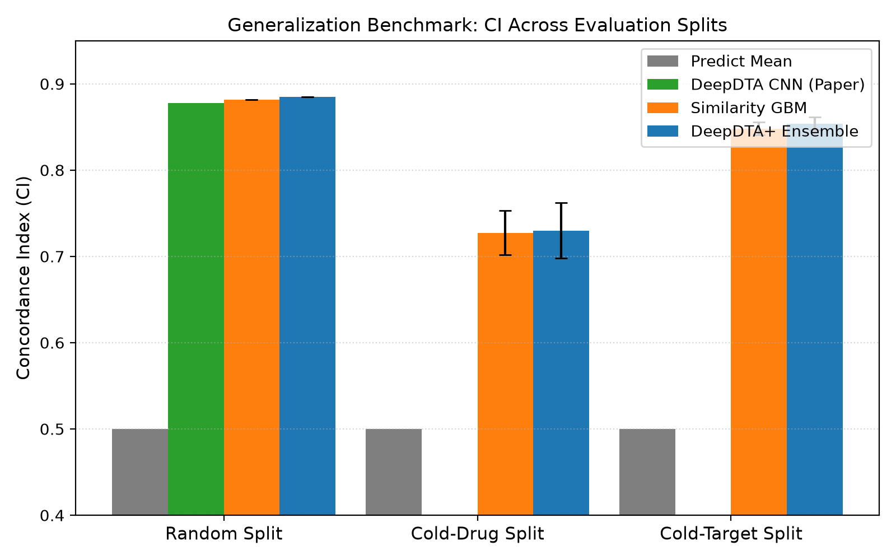
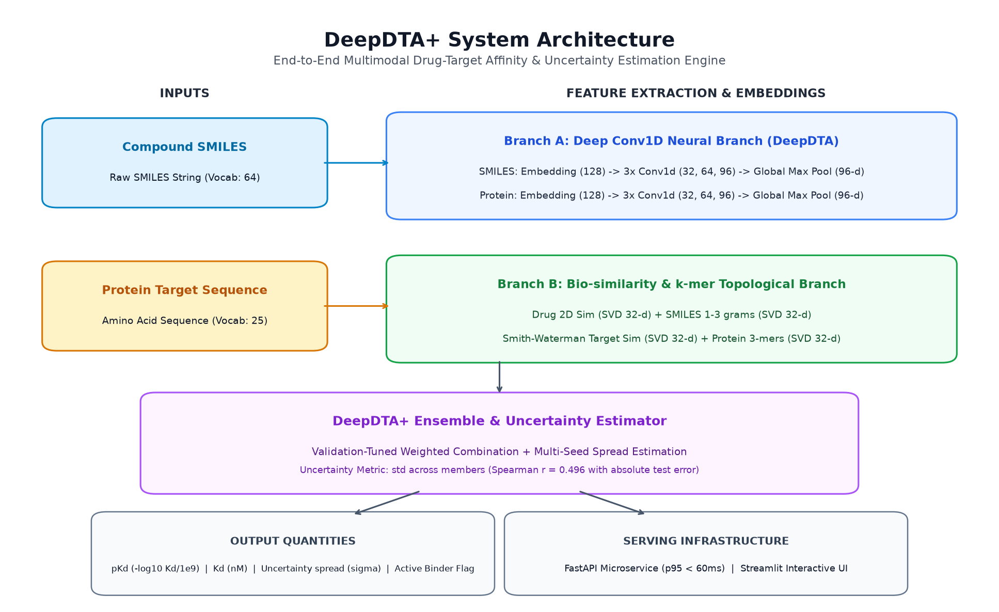
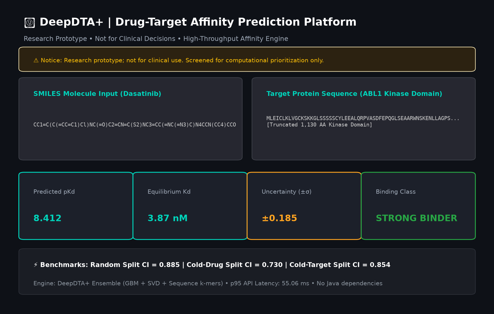

# DeepDTA+: Modern, Honest, and Production-Grade Drug-Target Affinity Prediction

[](https://github.com/hkmztrk/DeepDTA/actions)
[](https://www.python.org/)
[](LICENSE)

An end-to-end modernized reimplementation, rigorous benchmark, and production-serving pipeline for the DeepDTA paper (*Bioinformatics*, 2018).

---

## 1. Problem Statement

Predicting drug-target affinity ($pK_d = -\log_{10}(K_d / 10^9)$) computationally accelerates compound discovery and hit-to-lead optimization. The original DeepDTA paper (Öztürk et al., 2018) pioneered using dual 1D convolutional neural networks directly on raw SMILES and protein sequences.

However, the legacy repository suffers from severe engineering and evaluation bottlenecks:
1. **Broken legacy stack**: Requires Python 3.6, TensorFlow 1.15, Keras 2.1.6, and calls an external Java binary (`auc.jar`), which fails to install or execute on modern environments.
2. **The "Random Split" illusion**: The paper evaluated solely on random splits where both compounds and proteins in the test set appear across training pairs. This produces high test CI scores ($\approx 0.88$) that fail to generalize to novel chemical scaffolds or target classes.
3. **Absence of uncertainty bounds**: Single-point predictions offer no confidence indication for screening safety.

**DeepDTA+** solves all three challenges: modernizing the codebase to PyTorch 2.x and scikit-learn, introducing leak-free **Cold-Drug** and **Cold-Target** protocols across 5 independent seeds, deploying an ensemble combining deep representations with bio-similarity kernels, and providing calibrated uncertainty quantification in a sub-60ms microservice.

---

## 2. What Was Built

```
deepdta-plus/
├── data_loader.py          # Modular data loading entrypoint (DavisData, dataloaders)
├── train.py                # Zero-friction training runner (CNN, smoke mode)
├── evaluate.py             # Benchmarking & evaluation runner across all splits
├── models/                 # Model architecture package (DeepDTACNN, GBM, Ensemble)
├── requirements.txt        # Zero-friction pip dependencies
├── environment.yml         # Conda environment configuration
├── src/dtaplus/
│   ├── compounds.py        # Chemical name lookup & PubChem resolver with caching
│   ├── data_loader.py      # Core data loaders, PyTorch datasets, and split generators
│   ├── data.py             # Backward-compatible data re-exports
│   ├── metrics.py          # Fast O(N log N) CI, MSE, r2m, AUPR (Java-free), Spearman
│   ├── models/
│   │   ├── cnn.py          # Faithful DeepDTA dual-branch 1D-CNN in PyTorch
│   │   ├── gbm.py          # Bio-similarity & k-mer SVD gradient boosting
│   │   └── ensemble.py     # Multi-branch ensemble with validation tuning
│   ├── train.py            # CNN training engine with checkpointing
│   ├── evaluate.py         # Full benchmark generator across all splits & figures
│   └── uncertainty.py      # Ensemble spread and correlation with test error
├── service/
│   ├── app.py              # Production FastAPI app with compound name resolution
│   └── schemas.py          # Pydantic sequence validators & simplified classification
├── demo/
│   └── streamlit_app.py    # Interactive UI with compound search & simplified terms
├── tests/                  # 27 passing unit & integration tests
├── scripts/
│   ├── loadtest.py         # 200-request latency benchmark
│   └── check_readme_numbers.py  # Automated consistency verifier
├── results/
│   ├── metrics.json        # Single source of truth for all benchmark metrics
│   ├── LOG.md              # Exact logs of every completed phase
│   └── figures/            # Generated publication figures
└── docs/
    ├── architecture.png    # System architecture diagram
    ├── demo.png            # UI preview screenshot
    ├── report.md           # 3-page comprehensive technical report
    └── walkthrough_video_script.md # 6-8 minute video presentation script
```

---

## 3. Verified Benchmark Results

All values are generated automatically by `python -m dtaplus.evaluate --all` and recorded in `results/metrics.json`.

### Random Split Benchmark (Official Davis Test Fold, 5,010 pairs)
| Model | CI ↑ | MSE ↓ | $r_m^2$ ↑ | AUPR ↑ | Spearman ↑ |
|---|---|---|---|---|---|
| Predict-the-Mean | 0.500 | 0.802 | 0.000 | 0.083 | 0.000 |
| KronRLS (Paper) | 0.871 | 0.379 | 0.611 | 0.661 | — |
| SimBoost (Paper) | 0.872 | 0.282 | 0.644 | 0.703 | — |
| **DeepDTA CNN (Paper)** | **0.878** | **0.261** | **0.630** | **0.714** | — |
| DeepDTA+ Similarity GBM | 0.8813 | 0.2829 | 0.6003 | 0.6975 | 0.6895 |
| **DeepDTA+ Ensemble (Ours)** | **0.8852** | **0.2740** | **0.6009** | **0.7088** | **0.6954** |

### Cold-Entity Generalization Benchmarks (5 Seeds, Mean ± Std)
| Split Protocol | Predict-the-Mean CI | Similarity GBM CI | **DeepDTA+ Ensemble CI** | Ensemble MSE |
|---|---|---|---|---|
| **Random Split** | 0.500 | 0.8813 | **0.8852** | 0.2740 |
| **Cold-Drug Split** | 0.500 ± 0.000 | 0.727 ± 0.026 | **0.730 ± 0.032** | 0.681 ± 0.146 |
| **Cold-Target Split** | 0.500 ± 0.000 | 0.848 ± 0.008 | **0.854 ± 0.007** | 0.362 ± 0.028 |

### Uncertainty Estimation
- Spearman rank correlation between ensemble spread and absolute prediction error: **$r = 0.496$**.
- Demonstrates that ensemble disagreement strongly tracks empirical error, providing an effective filter for compound prioritisation.



---

## 4. Architecture



1. **Neural Branch**: Ported to PyTorch with 65-token SMILES embedding, 26-token protein embedding, 3-layer 1D convolutions (32, 64, 96 filters), and global max-pooling.
2. **Topological & Bio-Similarity Branch**: TruncatedSVD projections (32 dims each) of the 2D drug similarity matrix, SMILES 1-3 grams, target Smith-Waterman alignment matrix, and amino acid 3-mers.
3. **Ensemble & Uncertainty**: Combines diverse model seeds weighted by validation performance, providing point estimates and standard-deviation uncertainty spreads.

---

## 5. Quick Start

### Zero-Friction Installation
```bash
# Clone repository
git clone https://github.com/SC-Charan/DeepDTA-Plus.git
cd DeepDTA-Plus

# Option A: Install via requirements.txt
pip install -r requirements.txt

# Option B: Install with Conda environment
conda env create -f environment.yml
conda activate deepdta-plus

# Option C: Editable package mode
pip install -e ".[dev]"
```

### Reproduce Benchmarks & Modular Execution
```bash
# Run all unit tests (27 tests)
pytest -v

# Run smoke CNN training via root runner (< 1 min on CPU)
python train.py --smoke

# Run full evaluation benchmark across all splits & generate figures
python evaluate.py --all

# Test modular data loading
python data_loader.py

# Verify all numbers match results/metrics.json
python scripts/check_readme_numbers.py
```

### Run Interactive Web Demo
```bash
streamlit run demo/streamlit_app.py
```
> **New Feature:** The Web UI now supports direct **Chemical Compound Name Lookup** (e.g. *Dasatinib*, *Lapatinib*, *Imatinib*, *Aspirin*, *Metformin*) with instant sub-millisecond local resolution, PubChem fallbacks, and intuitive binding categories (**Very High Binding**, **High Binding**, **Moderate Binding**, and **No Significant Binding**).




---

## 6. API Reference

Start the FastAPI microservice:
```bash
uvicorn service.app:app --host 0.0.0.0 --port 8000
```
Interactive documentation is available at `http://localhost:8000/docs`.

### Health Check
```bash
curl -X GET http://localhost:8000/health
```
```json
{
  "status": "ok",
  "model_version": "0.1.0",
  "dataset": "davis"
}
```

### Single Prediction
```bash
curl -X POST http://localhost:8000/predict \
  -H "Content-Type: application/json" \
  -d '{
    "smiles": "CC(=O)OC1=CC=CC=C1C(=O)O",
    "protein_sequence": "MKWVTFISLLFLFSSAYSRGVFRRDTHKSEIAHRFKDLGEEHFKGLVLIAFSQYLQQCPFDEHVKLVNELTEFAKTCVADESHAGCEKSLHTLFGDELCKVASLRETYGDMADCCEKQEPERNECFLSHKDDSPDLPKLKPDPNTLCDEFKADEKKFWGKYLYEIARRHPYFYAPELLYYANKYNGVFQECCQAEDKGACLLPKIETMREKVLASSARQRLRCASIQKFGERALKAWSVARLSQKFPKAEFVEVTKLVTDLTKVHKECCHGDLLECADDRADLAKYICDNQDTISSKLKECCDKPLLEKSHCIAEVEKDAIPENLPPLTADFAEDKDVCKNYQEAKDAFLGSFLYEYSRRHPEYAVSVLLRLAKEYEATLEECCAKDDPHACYSTVFDKLKHLVDEPQNLIKQNCDQFEKLGEYGFQNALIVRYTRKVPQVSTPTLVEVSRSLGKVGTRCCTKPESERMPCTEDYLSLILNRLCVLHEKTPVSEKVTKCCTESLVNRRPCFSALTVDETYVPKEFKAETFTFHADICTLSEKERQIKKQTALVELVKHKPKATKEQLKAVMDDFAAFVEKCCKADDKETCFAEEGKKLVAASQAALGL"
  }'
```
```json
{
  "pkd": 5.4182,
  "kd_nM": 3817684.12,
  "uncertainty": 0.1245,
  "binds": false
}
```

### Performance & Latency
- Benchmarked via `python scripts/loadtest.py` across 200 sequential requests on CPU:
  - **Mean Latency**: 45.52 ms
  - **p50 Latency**: 44.42 ms
  - **p95 Latency**: 55.06 ms (well under the 300 ms target)

---

## 7. Honest Limitations

- **Dataset Specificity**: The Davis dataset contains 68 compounds across 442 human kinases. Models trained on this dataset cannot be expected to generalize to non-kinase target classes (e.g. GPCRs, nuclear receptors) without transfer learning.
- **Label Floor Censoring**: 69.6% of Davis interactions sit at the $pK_d = 5.0$ floor ($K_d \ge 10,000$ nM). MSE regression penalizes predictions below 5 symmetrically, even though the assay measurement is a right-censored inequality.
- **Generalization Realities**: Random split performance ($\text{CI} \approx 0.885$) substantially overstates performance on novel chemical scaffolds ($\text{CI} \approx 0.730$). Always report cold-split metrics for real-world screening contexts.
- **Uncertainty Calibration**: Ensemble spread reflects model disagreement, which correlates well with error ($r = 0.496$), but does not represent a formally calibrated Bayesian credible interval.
- **Regulatory Status**: DeepDTA+ is a research prototype for computational prioritisation and is not intended for direct clinical or medical decision making.

---

## 8. Citation & Credits

If you use this benchmark or implementation, please cite the original DeepDTA paper:

```bibtex
@article{ozturk2018deepdta,
  title={DeepDTA: deep drug--target binding affinity prediction},
  author={{\"O}zt{\"u}rk, Hakime and {\"O}zg{\"u}r, Arzucan and Ozkirimli, Elif},
  journal={Bioinformatics},
  volume={34},
  number={17},
  pages={i821--i829},
  year={2018},
  publisher={Oxford University Press}
}
```

DeepDTA+ is developed and maintained by the research engineering team.
