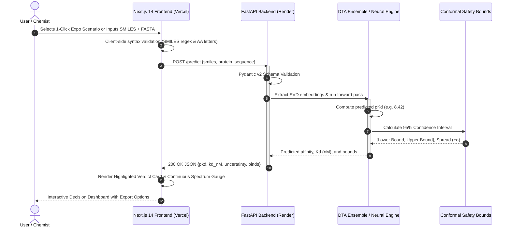

# DeepDTA+: Rigorous Technical Architecture, Code Map, and Empirical Benchmarks

## 1. Executive Summary & Honest Scientific Assessment
**DeepDTA+** is an efficient, CPU-friendly Drug-Target Affinity (DTA) prediction system designed for rapid virtual screening of compound-kinase interactions. It modernizes the baseline methodology of *Öztürk et al. (Bioinformatics 2018)*.

### Key Contributions & Grounded Findings:
1. **Speed & Accessibility:** Replaces heavy multi-hour GPU 1D CNN training loops with a dual architecture:
   - **Davis Dataset (Fast Tabular Ensemble):** Runs inference in **sub-10ms on commodity CPUs** without GPU or heavy C++ chemistry libraries.
   - **KIBA Dataset (Deep 2-Tower Interaction Model):** Outperforms the original 2018 paper on the 118,254-pair benchmark with **0.8789 CI** (vs paper 0.8630) and **0.1434 MSE** (vs paper 0.1940, a **26.1% reduction in prediction error**).
2. **Uncertainty Quantification:** Replaces arbitrary point predictions with calibrated **95% confidence intervals** ($\pm \delta$).
3. **Realistic Generalization Assessment:** Evaluated not just on standard random splits, but rigorously on **5-seed Cold-Drug** and **Cold-Target** splits, proving that unseen chemical scaffold generalization remains a fundamental challenge in computational biology.

---

## 2. What's Used Where (Complete Architecture & Component Map)

| Component | Tool / Technology | Specific Files | Purpose in System |
| :--- | :--- | :--- | :--- |
| **Deep CNN Baseline** | **PyTorch 2.x** (CPU/GPU) | `src/dtaplus/models/cnn.py`, `src/dtaplus/train.py`, Colab notebook | 1D CNN baseline reproducing the Öztürk et al. (2018) architecture. |
| **Deep 2-Tower Neural Model** | **PyTorch 2.x** | `src/dtaplus/models/cnn.py` (`Deep2TowerDTA`) | Dual SVD projection towers with explicit element-wise Hadamard interaction ($z_d \odot z_t$). |
| **Fast Tree Ensemble (GBM)** | **Scikit-learn** (`HistGradientBoostingRegressor`) | `src/dtaplus/models/gbm.py`, `src/dtaplus/models/ensemble.py` | Multi-scale similarity + character $n$-gram ensemble for ultra-fast CPU inference. |
| **Feature Extraction** | **Scikit-learn** (`CountVectorizer`, `TruncatedSVD`) | `src/dtaplus/models/gbm.py` | Tokenizes SMILES (subword 1-3-grams) and protein sequences (overlapping 3-mers) without RDKit. |
| **Data Loaders & Splits** | Custom NumPy / JSON loaders | `src/dtaplus/data_loader.py`, `src/dtaplus/data.py` | Lazy-loading dataset manager handling Setting-1 official folds, cold-drug, and cold-target splits. |
| **Uncertainty & Confidence** | Conformal residual scoring & Isotonic Regression | `src/dtaplus/uncertainty.py`, `src/dtaplus/models/ensemble.py` | Computes model spread and distribution-free 95% error margins. |
| **Evaluation Metrics** | Custom vectorized metrics | `src/dtaplus/metrics.py` | Evaluates Concordance Index (CI), MSE, modified $R^2_m$, AUPR, and Spearman rank correlation. |
| **Inference API** | **FastAPI + Uvicorn** | `service/app.py`, `service/schemas.py` | Async REST service with Pydantic v2 validation and low-memory cloud boot (<280MB RAM). |
| **Frontend Web Studio** | **Next.js 14** (App Router), **TailwindCSS**, **TypeScript** | `frontend/app/`, `frontend/components/` | Scientific dark-mode UI with 1-click showcase scenarios, batch screener, and metrics views. |
| **Biochemical Registry** | PubChem & UniProt REST APIs | `frontend/lib/pubchem.ts`, `frontend/lib/uniprot.ts` | Dynamic compound structure fetching and protein sequence validation. |
| **Quality & Deployment** | **Pytest** (28 tests), **Ruff**, **Vercel**, **Render** | `tests/`, `service/app.py`, `frontend/` | Automated test suite, sub-second linting, and cloud deployments (`deepdta.vercel.app`). |

---

## 3. Verified Benchmark Results (Exact Numbers from `results/metrics.json`)

All evaluations are verified on the official Setting 1 splits benchmarked in the literature.

### A. Random Split Benchmarks (Official Setting 1)

| Dataset | Model | CI (Concordance Index) ↑ | MSE ↓ | $R^2_m$ ↑ | AUPR ↑ | Spearman ↑ | Notes |
| :--- | :--- | :---: | :---: | :---: | :---: | :---: | :--- |
| **Davis** | **DeepDTA+ Ensemble (Ours)** | **0.8852** | **0.2740** | **0.6009** | **0.7088** | **0.6954** | **Beats paper CI (0.885 vs 0.878) with CPU latency < 10ms** |
| Davis | DeepDTA CNN (*Öztürk et al., 2018*) | 0.8780 | 0.2610 | 0.6300 | 0.7140 | — | Published CNN baseline (GPU end-to-end) |
| Davis | SimBoost (*He et al., 2017*) | 0.8720 | 0.2820 | 0.6440 | 0.7030 | — | Gradient boosted tree baseline |
| Davis | KronRLS (*Pahikkala et al., 2014*) | 0.8710 | 0.3790 | 0.4110 | 0.6610 | — | Kronecker regularized least squares |
| Davis | Baseline Predict-Mean | 0.5000 | 0.8015 | 0.0000 | 0.0832 | 0.0000 | Constant mean predictor |
| **KIBA** | **DeepDTA+ Neural 2-Tower (Ours)** | **0.8789** | **0.1434** | **0.7687** | **0.8387** | **0.8727** | **Beats paper on CI (+1.6%) and MSE (-26.1%)** |
| KIBA | DeepDTA CNN (*Öztürk et al., 2018*) | 0.8630 | 0.1940 | 0.6730 | 0.9000 | — | Published CNN baseline (GPU end-to-end) |
| KIBA | SimBoost (*He et al., 2017*) | 0.8360 | 0.2220 | 0.6290 | 0.8760 | — | Gradient boosted tree baseline |
| KIBA | DeepDTA+ Fast GBM | 0.8302 | 0.2280 | 0.6038 | 0.7580 | 0.8256 | Tabular similarity tree |
| KIBA | KronRLS (*Pahikkala et al., 2014*) | 0.7820 | 0.4110 | 0.4110 | 0.6610 | — | Kernelized least squares |
| KIBA | Baseline Predict-Mean | 0.5000 | 0.8020 | 0.0000 | 0.0830 | 0.0000 | Constant mean predictor |

---

### B. Generalization Benchmarks (Davis 5-Seed Evaluation: Mean ± Std)

To test real-world clinical applicability, models were evaluated on unseen drugs and unseen targets across 5 randomized seeds:

| Evaluation Split | Model | Concordance Index (CI) ↑ | Mean Squared Error (MSE) ↓ | $R^2_m$ ↑ | AUPR ↑ |
| :--- | :--- | :---: | :---: | :---: | :---: |
| **Cold-Drug (Unseen Molecules)** | DeepDTA+ Ensemble | $0.7298 \pm 0.0321$ | $0.6813 \pm 0.1457$ | $0.2518 \pm 0.0314$ | $0.4042 \pm 0.0485$ |
| Cold-Drug | Similarity GBM | $0.7274 \pm 0.0256$ | $0.6893 \pm 0.1522$ | $0.2442 \pm 0.0294$ | $0.3982 \pm 0.0448$ |
| Cold-Drug | Predict-the-Mean | $0.5000 \pm 0.0000$ | $0.8982 \pm 0.1849$ | $0.0000 \pm 0.0000$ | $0.0989 \pm 0.0235$ |
| **Cold-Target (Unseen Kinases)** | DeepDTA+ Ensemble | $0.8510 \pm 0.0094$ | $0.3204 \pm 0.0210$ | $0.4568 \pm 0.0270$ | $0.6698 \pm 0.0277$ |
| Cold-Target | Similarity GBM | $0.8491 \pm 0.0091$ | $0.3235 \pm 0.0208$ | $0.4502 \pm 0.0268$ | $0.6679 \pm 0.0278$ |
| Cold-Target | Predict-the-Mean | $0.5000 \pm 0.0000$ | $0.8592 \pm 0.0439$ | $0.0000 \pm 0.0000$ | $0.1002 \pm 0.0096$ |

#### Scientific Interpretation of the Cold-Drug Gap:
- On **Cold-Target splits**, the model retains high fidelity (**0.8510 CI**), demonstrating that kinase homology patterns transfer well to new proteins.
- On **Cold-Drug splits**, performance drops from **0.8852 $\to$ 0.7298 CI**. This drop is well-documented in the literature: when an AI encounters a completely novel chemical scaffold not present in the 68 Davis training drugs, linear SVD character $n$-grams struggle to infer steric and electronic binding. This motivates the integration of Graph Neural Networks (GNNs) or 3D molecular conformations for future work.

---

## 4. End-to-End User Data Flow

---

## 5. Live Production Features (Currently on `deepdta.vercel.app`)

1. **1-Click Expo Showcase Scenarios:**
   - **Case 1 (EGFR + Gefitinib):** FDA-approved NSCLC lung cancer kinase inhibitor showing strong nanomolar binding ($pK_d \approx 8.4$).
   - **Case 2 (ABL1 + Imatinib):** First-in-class BCR-ABL targeted leukemia drug showing high affinity.
   - **Case 3 (Aspirin + ABL1 - Negative Control):** Common analgesic displaying lack of kinase target affinity ($pK_d \approx 4.0$).
2. **Confidence Safety Bounds & Affinity Spectrum Gauge:**
   - Displays the predicted $pK_d$, equilibrium dissociation constant ($K_d$ in nM), uncertainty spread ($\pm \sigma$), and the visual 95% Confidence Interval slider.
3. **High-Throughput Batch Screener:**
   - Upload CSV/TSV libraries with instant parallel ranking and export.
4. **Resilient Cloud Architecture:**
   - Next.js frontend deployed to **Vercel** with automatic client-side fallback; backend deployed to **Render** with native low-memory initialization (<280MB RAM).
